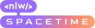
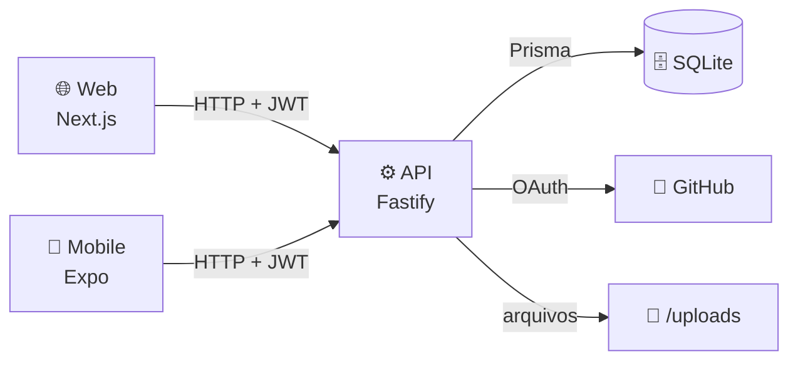
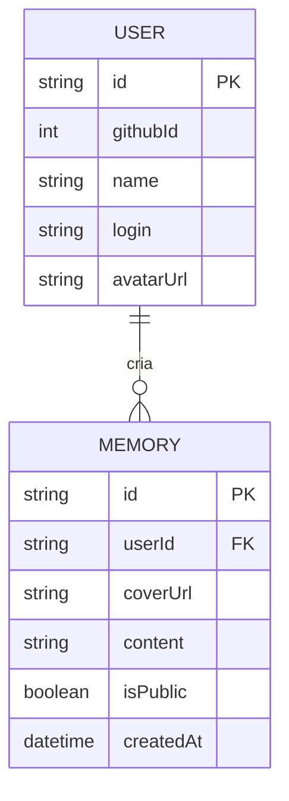

<div align="center">



# 🚀 Spacetime

**Sua cápsula do tempo de memórias.**<br/>
Guarde momentos marcantes com texto, foto ou vídeo, numa linha do tempo que é só sua.


<br/>


</div>

---

## 📑 Sumário

- [Sobre](#-sobre)
- [Funcionalidades](#-funcionalidades)
- [Arquitetura](#%EF%B8%8F-arquitetura)
- [Tecnologias](#-tecnologias)
- [API](#-api)
- [Rodando o projeto](#-rodando-o-projeto)

## 💡 Sobre

No **Spacetime** você entra com sua conta do GitHub e registra momentos marcantes: um texto, uma foto ou um vídeo de capa. As memórias aparecem numa **linha do tempo** organizada por data, e cada uma pode ser **pública ou privada**.

É um projeto **full stack** completo, todo em TypeScript: uma **API**, uma **versão web** e um **app mobile** que conversam com ela.

## ✨ Funcionalidades

| | Funcionalidade | Detalhes |
| :---: | --- | --- |
| 🔐 | **Login com GitHub** | OAuth; o usuário é criado no primeiro acesso e recebe um JWT válido por 30 dias |
| 🕰️ | **Linha do tempo** | memórias ordenadas por data, com capa e um trecho do texto |
| 📝 | **Nova memória** | texto, capa (imagem ou vídeo) e opção de deixar pública |
| ✏️ | **Editar e excluir** | só o dono da memória pode alterar ou apagar |
| 🔒 | **Privacidade** | memórias privadas só abrem para quem as criou |
| 📤 | **Upload de mídia** | imagens e vídeos de até 5 MB |

## 🏗️ Arquitetura



```
server/   # API (Fastify + Prisma)
web/      # versão web (Next.js)
mobile/   # app mobile (React Native + Expo)
```

## 🛠 Tecnologias

| Parte | Tecnologias |
| --- | --- |
| ⚙️ **API** | Node.js · Fastify · Prisma (SQLite) · Zod · @fastify/jwt · @fastify/multipart · @fastify/static · @fastify/cors · Axios |
| 🌐 **Web** | Next.js 13 (App Router) · React 18 · Tailwind CSS · Day.js · js-cookie · jwt-decode · Lucide |
| 📱 **Mobile** | React Native · Expo · Expo Router · NativeWind |

## 📡 API

| Método | Rota | Autenticação | O que faz |
| :---: | --- | :---: | --- |
|  | `/register` | — | recebe o código do GitHub e devolve o JWT |
|  | `/memories` | 🔒 | lista as memórias do usuário |
|  | `/memories/:id` | 🔒 | detalhes de uma memória |
|  | `/memories` | 🔒 | cria uma memória |
|  | `/memories/:id` | 🔒 | edita uma memória |
|  | `/memories/:id` | 🔒 | exclui uma memória |
|  | `/uploads` | — | envia a capa (imagem ou vídeo, até 5 MB) |

Os arquivos enviados ficam em `server/uploads` e são servidos em `/uploads`.

### 🗄️ Banco de dados



## 🚀 Rodando o projeto

> [!IMPORTANT]
> Antes de tudo, crie um **OAuth App** no GitHub (*Settings → Developer settings → OAuth Apps*), com a URL de callback apontando para a versão web.

### 1️⃣ API

```bash
cd server
npm install
```

Crie o arquivo `server/.env`:

```env
DATABASE_URL="file:./dev.db"
GITHUB_CLIENT_ID=seu_client_id
GITHUB_CLIENT_SECRET=seu_client_secret
```

```bash
npx prisma migrate dev
npm run dev        # 🚀 http://localhost:3333
```

### 2️⃣ Web

```bash
cd web
npm install
npm run dev        # 🌐 http://localhost:3000
```

### 3️⃣ Mobile

```bash
cd mobile
npm install
npx expo start     # 📱 abra no Expo Go ou no emulador
```

---

<div align="center">

Feito por **Ricardo Baldrez** 👋

[](https://ricardobaldrez.vercel.app)
[](https://www.linkedin.com/in/ricardo-barbosa-baldrez-38b760145)

</div>
